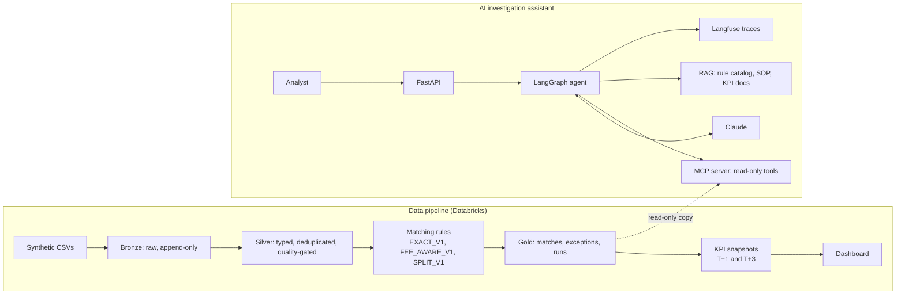

# Payment-to-Ledger Reconciliation with an AI Investigation Assistant

A data pipeline that checks whether every card payment matches an entry in the accounting ledger, reports how much reconciled, and lets analysts ask an AI assistant to explain the payments that don't match.

**Design rule: deterministic rules decide; the AI only explains.** Matching is done by versioned, testable rules. The assistant can look up records and the rulebook, but it can never change data or mark anything reconciled.

Built on free tiers: PySpark, Databricks Free Edition (Delta tables, Unity Catalog, Jobs), LangGraph, MCP, Chroma, Claude, FastAPI, Langfuse and GitHub Actions.

## The problem

A card processor sends money a few days after a sale, often net of fees and sometimes in several pieces. Accounting books what should have arrived in the general ledger. Reconciliation pairs each payment with its ledger entries and flags anything that doesn't line up. Those flags are **exceptions**, and analysts have to investigate each one.

This project does three jobs:

1. **Match** payments to ledger lines with deterministic rules.
2. **Report** a transaction rate and a dollar rate at preliminary (T+1) and final (T+3) cutoffs.
3. **Explain** exceptions through a read-only AI assistant that cites its evidence.

## Architecture



## Results

Measured on the generated dataset (1,000 payments, 1,120 ledger lines, 221 fees, 7 planted breaks):

| Rule | Payments matched | Ledger lines |
| --- | --- | --- |
| `EXACT_V1` | 700 | 700 |
| `FEE_AWARE_V1` | 220 | 220 |
| `SPLIT_V1` | 73 | 191 |

All 7 planted breaks are reported as exceptions with the correct reason code, and nothing else is: `MISSING_IN_LEDGER`, `MISSING_IN_PROCESSOR`, `AMOUNT_MISMATCH`, `FEE_MISMATCH`, `SPLIT_SUM_MISMATCH`, `DUPLICATE_CANDIDATE`, `AMBIGUOUS_MATCH`.

| KPI | T+1 (preliminary) | T+3 (final) |
| --- | --- | --- |
| Transaction rate | 71.2% | 99.3% |
| Dollar rate | 67.22% | 99.73% |

The jump from T+1 to T+3 comes from ledger lines that post one or two days late, which is why finance teams report both cutoffs.

**AI assistant evaluation:** _fill in your score_ / 15 questions answered correctly (target 12), including a refusal to change data.

## Key design decisions

- **Deterministic, versioned rules.** Every match stores its `rule_id` and `run_id`, so any result can be traced and reproduced. Running the same input twice gives identical output.
- **Uniqueness before matching.** A match is accepted only if the payment has exactly one candidate and the candidate has exactly one payment. Duplicates and ambiguous cases go to a human instead of being guessed.
- **Money in integer cents.** No floating-point rounding errors.
- **No tolerances.** Loosening rules to reduce exception counts could hide real financial breaks.
- **Medallion layers.** Bronze is append-only raw data, Silver has quality gates and a quarantine table, and Gold holds results with lineage.
- **Append-only KPI snapshots.** A published number is never overwritten; late data adds a new snapshot.
- **Read-only AI.** Tools run fixed, parameterized SQL on a read-only database. The model picks a tool and an ID but never writes SQL. A guardrail blocks requests to change data, and a final check rejects answers that name a reason code no tool returned.
- **Measured, not trusted.** A 15-question evaluation with known answers scores the assistant, and Langfuse traces every tool call, token count and latency.

## Repository layout

```
data/synthetic/generate.py        Synthetic payments, ledger and fees with planted breaks
reconciliation/matching.py        Matching rules and exception classification (PySpark)
tests/test_matching.py            Regression tests: breaks caught, determinism, no reuse, money ties out
databricks/                       Notebooks: 01_bronze, 02_silver, 03_gold, 04_kpis
assistant/export_to_duckdb.py     Local read-only copy of Gold and KPI tables
assistant/tools.py                Read-only lookup tools
assistant/rag.py                  Chroma index and search over docs/
assistant/mcp_server.py           MCP server exposing the tools
assistant/agent.py                LangGraph agent: guardrail, agent, tools, check
api/main.py                       FastAPI endpoints
docs/                             Rule catalog, exception SOP, KPI definitions
evaluations/                      15 questions with known answers and the scoring script
.github/workflows/ci.yml          Lint and tests on every push
```

## How to run it

Requires Python 3.10+ (3.12 recommended) and Java 17 or 21.

```bash
python -m venv .venv && source .venv/bin/activate
pip install -r requirements.txt

# 1. Generate data, run matching, run tests
python data/synthetic/generate.py
python reconciliation/matching.py
pytest -q

# 2. Build the assistant's local data and search index
python assistant/export_to_duckdb.py
python assistant/rag.py

# 3. Ask the assistant (copy .env.example to .env and add your Anthropic API key)
python assistant/agent.py "Why is PAY-000003 unmatched?"

# 4. Run the API, then open http://127.0.0.1:8000/docs
uvicorn api.main:app --reload

# 5. Score the assistant
python evaluations/run_eval.py
```

To run the pipeline on Databricks, connect this repo as a Git folder in Databricks Free Edition and run the notebooks in `databricks/` in order, or chain them as a Job.

## What's next

- Tableau dashboard and a KPI restatements table
- Full 40-question evaluation with hard-fail checks for data exposure
- Docker image, deployed to Azure Container Apps
- Azure Data Lake Storage for raw files and Key Vault for secrets
- Entra ID sign-in with Analyst and Admin roles
- Larger synthetic datasets and performance tests

## Note on data

All data is synthetic and generated by `data/synthetic/generate.py`. No real payment or banking data is used.
